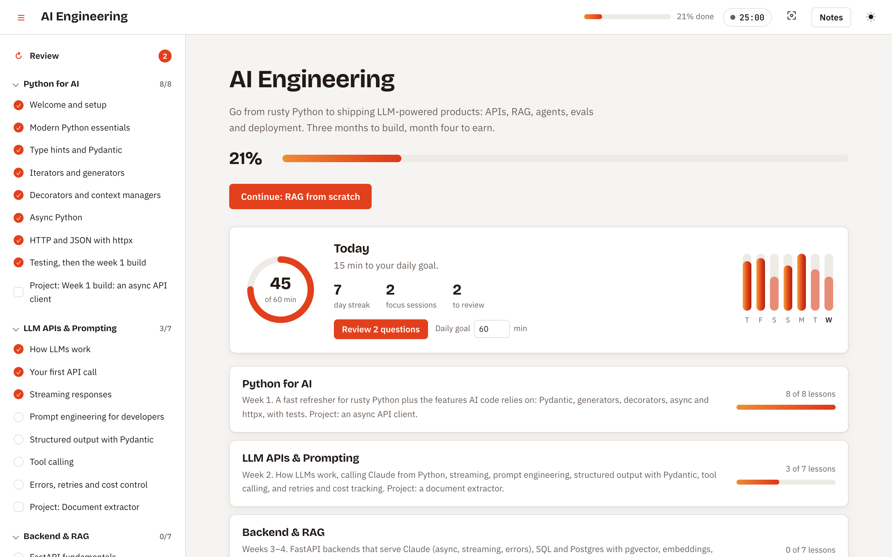
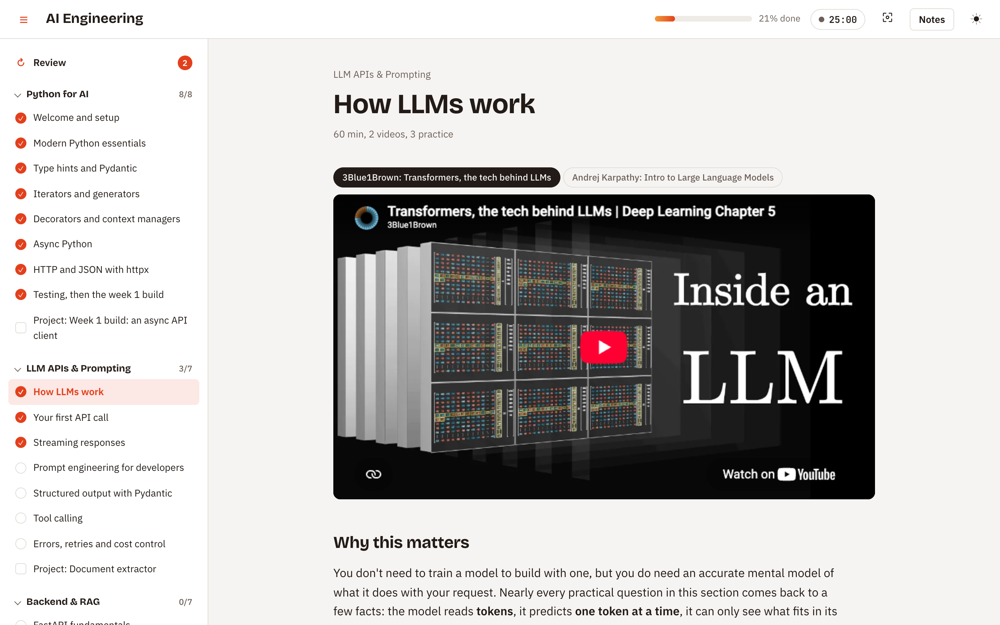
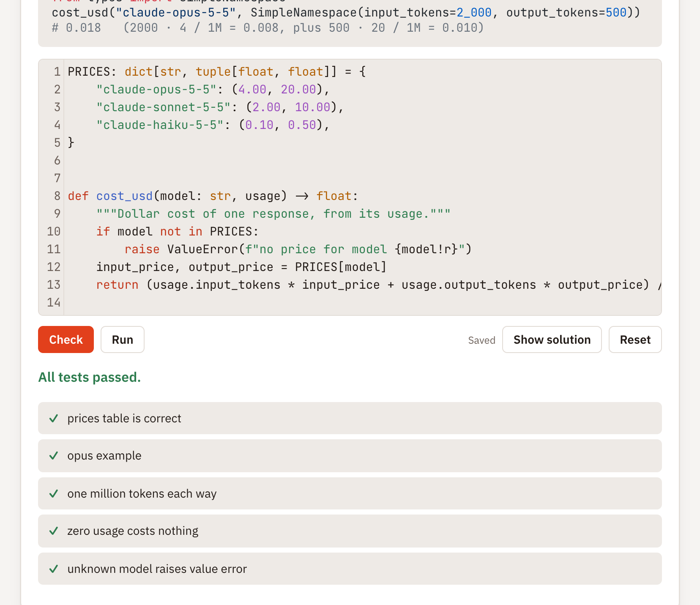
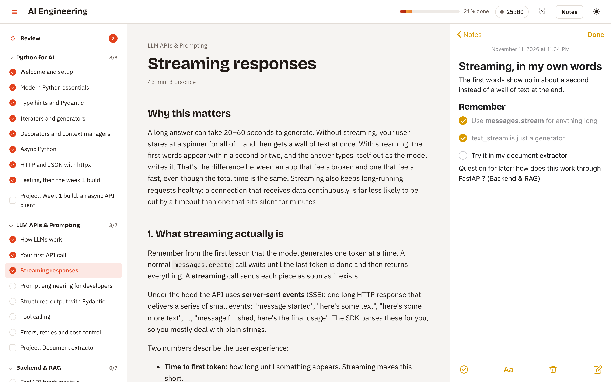
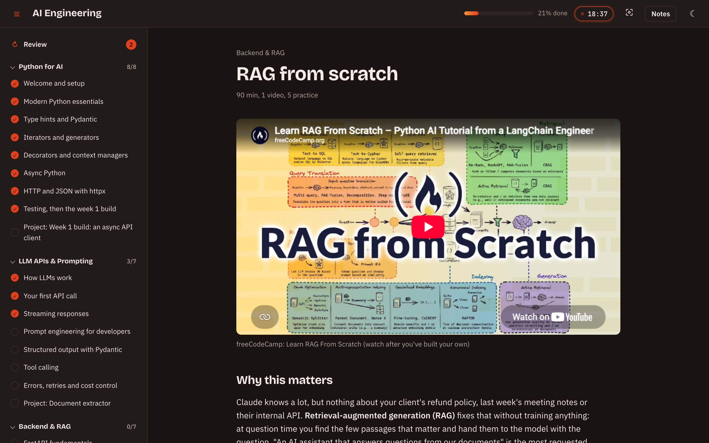

# LearnPack

**A local, Udacity-style learning platform that turns a folder of JSON and Markdown into a full course.**

Written lessons with embedded videos, practice exercises you write and run with real Python or TypeScript and check against hidden tests, quizzes, Apple Notes-style notes, section projects, a focus timer, study streaks and spaced review. All of it runs on your own computer, with your progress saved as plain files.

The platform knows nothing about any subject. Every course is a **course pack**: drop a folder into `courses/` and you get a complete course interface for it. Anyone can write a pack, share it or sell it.



<table>
  <tr>
    <td width="50%"><br><sub><b>Lessons:</b> videos plus a full written page</sub></td>
    <td width="50%"><br><sub><b>Practice:</b> write real code, and Check runs hidden tests</sub></td>
  </tr>
  <tr>
    <td width="50%"><br><sub><b>Notes:</b> Apple Notes-style, one per lesson, searchable</sub></td>
    <td width="50%"><br><sub><b>Dark mode</b> and the focus timer</sub></td>
  </tr>
</table>

```
courses/
├── ai-engineering/     ← included, free: Python → shipping LLM products in 3 months
└── your-course/        ← write your own: docs/writing-packs.md
```

---

## Contents

- [Quick start](#quick-start)
- [What you get](#what-you-get)
- [Included courses](#included-courses)
- [Course packs](#course-packs)
- [How it works](#how-it-works)
- [Documentation](#documentation)
- [Contributing](#contributing)
- [License](#license)

---

## Quick start

**You need:** [Python 3.10+](https://www.python.org/downloads/). For JavaScript/TypeScript courses you also need [Node.js 24+](https://nodejs.org/). A modern browser.

1. **Download** this repository: **Code → Download ZIP** on GitHub, then unzip it. Or clone it:
   ```bash
   git clone https://github.com/theolodocoder/learnpack.git
   ```
2. **Start it:**
   - **Mac:** double-click **`Start Learning.command`**
   - **Windows:** double-click **`Start Learning.bat`**
   - **Linux / terminal:**
     ```bash
     python3 server.py
     ```

   Your browser opens at http://localhost:8000. Keep the small window that appears open while you study; closing it stops the app.

The first launch takes about a minute while it installs the packages the exercises use. Every launch after that is instant.

> **Mac, first time only:** if macOS says the file is from an unidentified developer, right-click `Start Learning.command` → **Open** → **Open**.

The full walkthrough, including API keys for the AI course and troubleshooting, is in **[docs/getting-started.md](docs/getting-started.md)**.

---

## What you get

| | |
|---|---|
| **Lessons** | Full written pages (Markdown, highlighted code), embedded YouTube videos and playlists, "Go deeper" links |
| **Practice** | Code exercises in Python, JavaScript or TypeScript: **Run** shows your output, **Check** runs hidden tests and reports each one as passed or failed, **Show solution** reveals the answer. Plus multiple-choice quizzes with explanations |
| **Projects** | A project per section, with a brief, a tickable checklist, and fields for your repo and live URL |
| **Notes** | An Apple Notes-style drawer: rich text, checklists, headings, search, one note per lesson plus free notes |
| **Focus** | A Pomodoro timer in the top bar, and focus mode (press **F**) to go full screen |
| **Progress** | Mark lessons done, see progress per section, pick up where you left off |
| **Study stats** | Minutes studied today against a daily goal, a day streak and a 7-day chart |
| **Review** | Quiz questions you miss come back 1, 3, 7 and 14 days later until you've learned them |
| **Your data** | Plain files in `learner-data/`: progress (JSON), notes (HTML), your code. Nothing leaves your machine |
| **Look** | Light and dark mode. Each course sets its own colour and can restyle anything |

---

## Included courses

### AI Engineering
*`courses/ai-engineering/`: Python exercises*

From rusty Python to shipping LLM-powered products in about 3 months: Python for AI, LLM APIs and prompting, FastAPI and RAG, agents and evals, shipping (Docker, CI, tracing), a capstone product, and getting paid work. An optional maths track runs alongside.

That's 53 lessons and 89 exercises. The exercises that call Claude are checked against a fake client, so **Check** is always free and offline. Add an API key to try them for real with **Run**.

Every video and link was checked to exist before release. Every exercise's reference solution passes its own tests, and CI re-checks this on every change.

More course packs will be available separately. Any pack drops into `courses/` the same way.

---

## Course packs

A course pack is one folder:

```
courses/my-course/
├── course.json              ← describes the whole course
├── lessons/…/*.md           ← written lessons
├── practice/<id>/           ← prompt.md, starter, tests, solution (.py / .js / .ts)
├── projects/*.md            ← project briefs
├── theme.css                ← optional styling add-on
└── support/                 ← optional helpers for exercises (e.g. fake API clients)
```

`course.json` controls everything: the content, the language its exercises use, which features the interface shows (`notes`, `timer`, `focusMode`, `studyStats`, `review`), and how it looks (`theme.accent`, `theme.css`). There is deliberately no settings screen: a course is configured by its pack.

```json
{
  "format": 1,
  "id": "my-course",
  "title": "My Course",
  "version": "1.0.0",
  "author": { "name": "You" },
  "license": "CC-BY-4.0",
  "language": "typescript",
  "features": { "timer": false },
  "theme": { "accent": "#0F766E" },
  "sections": [ { "include": "sections/basics.json" } ]
}
```

Check a pack before you share it:

```bash
python3 server.py validate courses/my-course
```

This checks the structure, ids and file references, then **runs every exercise's reference solution against its tests**.

- **Write a pack:** [docs/writing-packs.md](docs/writing-packs.md). Covers writing by hand, writing with AI, and distributing or selling packs.
- **Full format reference:** [docs/pack-format.md](docs/pack-format.md), plus the machine-readable [`course.schema.json`](course.schema.json).
- **Smallest working example:** [`courses/_template/`](courses/_template/).

---

## How it works

```
Browser (web/: plain HTML, CSS, JS; no build step)
   │  JSON API over 127.0.0.1, with a per-launch token
   ▼
server.py (Python standard library only)
   ├── engine/pack.py     loads + validates course packs
   ├── engine/runner.py   runs learner code: Python, or Node for JS/TS
   └── learner-data/      progress, notes, saved code (plain files)
```

- **No database, no build step, no accounts.** The server has no third-party dependencies.
- Learner code runs as a real local process with a 60-second limit. Python exercises use the course's `.venv` if it exists, so they can import real packages; JavaScript and TypeScript run on Node 24, which runs `.ts` directly.
- Hidden tests run in a temporary folder. The browser never receives a test file or a solution unless the learner clicks **Show solution**.

More detail is in [CONTRIBUTING.md](CONTRIBUTING.md#architecture).

---

## Documentation

| Guide | For |
|---|---|
| [Getting started](docs/getting-started.md) | Installing, launching, API keys, troubleshooting |
| [Writing packs](docs/writing-packs.md) | Creating, validating and distributing your own courses |
| [Pack format reference](docs/pack-format.md) | Every field of `course.json` |
| [Contributing](CONTRIBUTING.md) | Developing the platform: setup, architecture, tests |
| [Security](SECURITY.md) | What the app protects against, and what it doesn't |

---

## Contributing

Bug reports, fixes, features and new course packs are all welcome. See [CONTRIBUTING.md](CONTRIBUTING.md).

```bash
pip install pytest && python -m pytest -q   # platform tests
node --test tests/study.test.js             # study logic tests
python3 server.py validate courses/<id>     # a course pack
```

---

## License

- **Platform code:** [MIT](LICENSE) © 2026 Promise Okafor.
- **Included course packs:** written content under [CC BY 4.0](https://creativecommons.org/licenses/by/4.0/), as declared in each pack's `course.json`.
- **Linked videos and articles:** they belong to their creators. Packs link to and embed them; they never copy them.
- **Your own packs:** any licence you choose.
